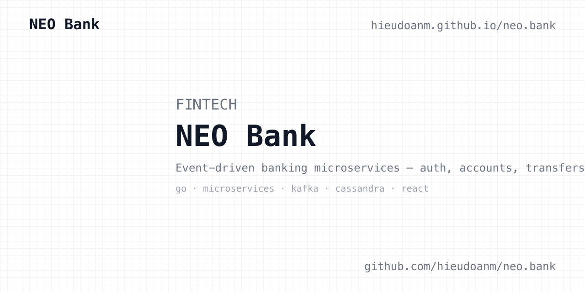

# neo.bank

[](https://github.com/hieudoanm/neo.bank/actions/workflows/ci.yaml?branch=master)  [](LICENSE)

Topics: `banking`, `microservices`, `go`, `event-driven`, `nextjs`


A full-stack banking application demonstrating core financial operations —
account registration, authentication, balance inquiry, and fund transfers —
built as an event-driven microservices system.



**Live demo:** <https://hieudoanm.github.io/neo.bank/>

## Architecture



The frontend talks only to the API Gateway; the Transfer Service orchestrates
the debit/credit saga over Kafka (`transfers`, `transfers.dlq`), and each
service owns its own Cassandra keyspace.

- **Backend**: Go 1.22+ microservices (Gin, Cassandra via gocql, Kafka).
- **Frontend**: React 19 + TypeScript, TanStack Query, Tailwind/daisyUI.
- **Infra**: Docker Compose for local development; Terraform + Kubernetes
  manifests under `infrastructure/` for cloud deployment.

## Repository layout

```text
packages/
  backend/
    api-gateway/      # Routing, JWT auth enforcement, rate limiting, CORS
    auth/             # Registration, login, JWT issuance, refresh tokens
    accounts/         # Account balances (LWT/paxos updates)
    transfer/         # Transfer saga orchestrator
    transactions/     # Transaction read model (Kafka projection)
  frontend/app/       # React + TypeScript SPA
infrastructure/       # Terraform (AWS/GCP) and Kubernetes manifests
docs/                 # Normative project documentation (start at docs/README.md)
scripts/              # Coverage enforcement and other helpers
```

## Get Started

One-command setup — creates `.env` with a generated development RSA key pair
and starts the full stack:

```sh
./scripts/install.sh
```

Or manually:

```sh
cp .env.example .env   # fill in JWT keys (see comments in the file)
docker compose up --build
```

The frontend is served at <http://localhost:3000>; the API gateway listens on
<http://localhost:8080> (`/healthz`, `/readyz` at the root, API under `/api/v1`).

## Usage

```sh
make build       # build all backend modules and the frontend
make test        # backend coverage-gated tests + frontend vitest
make typecheck   # go vet + tsc --noEmit
make lint        # gofmt + go vet + frontend ESLint
```

Backend tests currently use fakes and require no external services; real
Cassandra/Kafka integration tests are planned per `docs/09-testing-strategy.md`.

## Documentation

`docs/` contains the normative specifications: requirements, features, data
model, API specification, UI/UX design, tech stack, testing strategy, and
deployment/operations guides. Read `AGENTS.md` for contributor conventions.

## License

This project is licensed under the [GPL-3.0 License](LICENSE).
